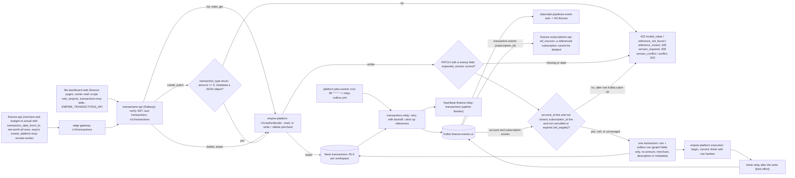

# 01 — Business process (As-Is / To-Be)

finance-transactions-api คือ cell ของ finance suite ที่เป็นบัญชีรายการเงินเข้าออก: หนึ่งแถวต่อรายรับ รายจ่าย โอน คืนเงิน ค่าธรรมเนียม หรือปรับยอด พร้อมวันที่ ยอด สกุลเงิน scope หมวด และ account กับ subscription ที่เกี่ยวข้อง ผู้ใช้คือ owner ผ่าน life-dashboard-web, finance-api (overview, budget vs actual, net worth, export, erase) และ MCP; ทุกการเขียนส่ง event ที่มีแต่ข้อมูลอ้างอิงไป Kafka `finance.events.v1`

Last reviewed: 2026-11-27 · commit `5e6aa83`

## As-Is (จากโค้ดวันนี้)

Sources: `cell.yaml`, `pyproject.toml` (platform-cellkit 1.1.1, entry points), `.github/workflows/relay-outbox.yml`, `migrations/0003_finance_events.sql`, `migrations/0004_cross_references.sql`, `README.md`, `PRODUCT.md`, `REVIEW.md`, `AGENTS.md`, `specs/005-finance-events-kafka/spec.md`, `specs/006-cross-service-references/spec.md`, `specs/007-date-range-filters/spec.md`, `specs/008-workspace-erase/spec.md`, `specs/009-money-patch-version/spec.md`; platform-cellkit `v1.1.1` `src/cellkit/app.py`, `relay.py`, `refs.py`, `server.py`, `gateway.py`; callers: finance-api `src/finance_api/app.py` (`RESOURCES`, `SOURCES`, `ERASE_STAGES`, `load_month`), life-dashboard-web `lib/cells/finance.ts`, `lib/cells/owner-cash.ts`, finance-subscriptions-api `cell.yaml` (`referenced_by`), platform-jobs-worker `src/jobs.ts`

ข้อเท็จจริงสำคัญจากโค้ด:

- resource เดียว `transaction` ที่ `/v1/transactions`: list (filter `account_id`, `category`, `transaction_type`, `scope`, ช่วง `transaction_date_from` / `transaction_date_to`; เรียงตาม `transaction_date` แล้ว id), stats, get, get-by-legacy-id, create (`Idempotency-Key`), patch, delete, `POST /v1/transactions/erase` (batch 1–500 ค่าเริ่ม 200)
- `amount` ไม่ติดลบ ทิศทางเงินมาจาก `transaction_type`; ยอดคงเหลือไม่ได้คำนวณใน cell นี้ (ผู้อ่านคำนวณเอง)
- กันบันทึกซ้ำได้เพียง `Idempotency-Key` ตอน create และ `legacy_id` ที่ไม่ซ้ำ (409); รายการเดียวกันส่งสองครั้งโดยไม่มี key จะถูกเก็บสองแถว
- `account_id` และ `subscription_id` ถูกตรวจกับสำเนาจาก event (SPEC-006) ไม่ได้เรียก finance-accounts-api หรือ finance-subscriptions-api ตรง; patch ที่ไม่เปลี่ยนสอง field นี้ไม่ถูกตรวจซ้ำ
- event ใส่เฉพาะ `transaction_date`, `transaction_type`, `currency`, `account_id`, `scope`, `subscription_id`
- finance-api ลบ transaction ในขั้นแรกของ erase (ก่อน subscription และ account ที่มันชี้)
- `transactions-mcp` (stdio) มี tool `transactions.transaction.list|get|create|update|delete` ที่เรียก API ด้วย token ของผู้เรียก (`EMPIRE_MCP_READONLY=1` = อ่านอย่างเดียว)
- life-dashboard-web เรียกผ่าน `EMPIRE_TRANSACTIONS_API` ซึ่ง URL จริง (ตรงหรือผ่าน gateway) อ่านจากโค้ดไม่ได้ [ต้องยืนยัน]
- โหมด `GATEWAY_ASSERTION_MODE` และโหมด signed events ที่ production ตั้งไว้ อ่านจากโค้ดไม่ได้ [ต้องยืนยัน]

## To-Be (จาก `PRODUCT.md` §Measures และ `specs/004-identity-issuer-trust/spec.md`)

ไม่มีแผนภาพ To-Be ของกระบวนการ: specs 001–009 อยู่ในโค้ดแล้ว เหลือเพียงสิ่งที่เอกสารเขียนไว้ว่ายังไม่ทำ:

- `PRODUCT.md` §Measures (proposed, ยังไม่มีอะไรเก็บ): จำนวน transaction ต่อสัปดาห์แยกตาม `source`, transaction ที่ `account_id` หา account ไม่เจอ (เป้า 0), 5xx และ p95 latency ของ `/v1/transactions`
- `specs/004-identity-issuer-trust/spec.md`: โค้ดรับ issuer ที่สอง (platform-identity) ได้แล้ว แต่การเปิดใช้ใน production ต้องได้ owner go แยก

## Gap

| ID | As-Is → To-Be | Status | Owner | Evidence |
|---|---|---|---|---|
| G1 | ไม่มีอะไรเก็บ measures → วัด transaction ต่อสัปดาห์ตาม `source` และ transaction ที่ account หาไม่เจอ (SPEC-006 กันตอนเขียนแล้ว แต่ไม่มีตัววัด) | todo | claude | `PRODUCT.md` §Measures ("nothing collects them yet") |
| G2 | รองรับ issuer platform-identity ในโค้ดแล้ว → owner go ให้เปิดใน production (สถานะตัวแปรจริง [ต้องยืนยัน]) | decide | owner | `specs/004-identity-issuer-trust/spec.md` Status; platform-cellkit `src/cellkit/server.py` `_identity_trust` |
| G3 | `PRODUCT.md` ยังเขียนว่า `account_id` และ `subscription_id` ไม่ถูกตรวจกับ service อื่น → แก้ให้ตรงกับ SPEC-006 (ตรวจกับ `ref_targets`, refuse closed / cancelled / expired) | todo | claude | `PRODUCT.md` §Capabilities; `cell.yaml` `references`; `specs/006-cross-service-references/spec.md` |

## Open questions

- life-dashboard-web และ cell นี้คุยกันตรงหรือผ่าน edge gateway และ cell ตั้ง `GATEWAY_ASSERTION_MODE` เป็น enforce แล้วหรือยัง [ต้องยืนยัน]
- `PRODUCT.md` บอกว่า finance-portfolio-web อ่าน `/api/finance/v1/transactions` ผ่าน `FINANCE_API_BASE_URL`; ปลายทางนั้นถึง cell นี้หรือไม่ [ต้องยืนยัน]
- รายการเข้ามาจากไหนบ้างในการใช้งานจริง (`source` ค่าเริ่ม `manual`; ไม่พบ importer อัตโนมัติในโค้ดที่อ่าน) [ต้องยืนยัน]
